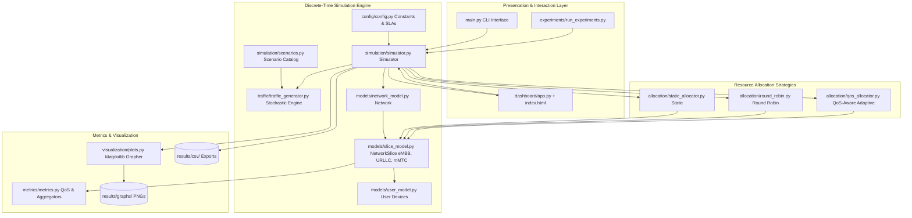
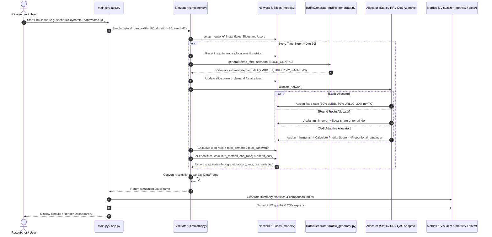

# Global System Architecture & End-to-End Execution Flow

## 1. Executive Summary & Core Objective

The **Adaptive 5G Network Slicing Simulator** simulates a 5G core and Radio Access Network (RAN) slicing environment with three heterogeneous network slices:
1. **eMBB (Enhanced Mobile Broadband):** High-throughput applications (e.g., 4K/8K video streaming, AR/VR, large file downloads). Sensitive to throughput drops; tolerant of moderate latency.
2. **URLLC (Ultra-Reliable Low-Latency Communications):** Mission-critical, safety-critical traffic (e.g., autonomous vehicle telemetry, industrial robot control, remote surgery, emergency services). Extremely sensitive to latency ($<5\text{ ms}$) and packet loss ($<1\%$).
3. **mMTC (Massive Machine-Type Communications):** Massive IoT sensor networks (e.g., smart meters, environmental sensors). Characterized by high device density, small intermittent packets, and low bandwidth demands.

The central problem addressed is **dynamic resource contention under a finite transmission medium (e.g., 100 Mbps total bandwidth)**. When aggregate demand exceeds total capacity, static allocation leads to under-utilization or severe QoS failure, while blind fair sharing (Round Robin) fails to protect mission-critical traffic. The simulator implements and evaluates a **QoS-Aware Adaptive Allocation Algorithm** that prioritizes slices facing QoS SLA breaches while guaranteeing starvation-prevention minimums.

---

## 2. High-Level System Architecture Diagram

---

## 3. End-to-End Execution Flow (Chronological Sequence)

The simulation operates in discrete time steps (1 step = 1 second) across a predefined duration (default $T = 60\text{ seconds}$).

---

## 4. Mathematical Models & Formulation

### 4.1. Instantaneous Throughput
The physical delivered throughput $\Theta_i(t)$ for slice $i$ at time step $t$ is constrained by the minimum of actual user demand $D_i(t)$ and allocated bandwidth $B_i(t)$:
$$\Theta_i(t) = \min(D_i(t), B_i(t))$$

### 4.2. Packet Loss Percentage
When aggregate traffic demand $D_i(t)$ exceeds allocated bandwidth $B_i(t)$, transmission queues overflow, resulting in dropped packets:
$$L_i(t) = \begin{cases} 
0\% & \text{if } D_i(t) \le B_i(t) \\
\left( \frac{D_i(t) - B_i(t)}{D_i(t)} \right) \times 100 & \text{if } D_i(t) > B_i(t)
\end{cases}$$

### 4.3. Latency Model
Network latency $\Lambda_i(t)$ comprises baseline propagation/processing latency $\Lambda_i^{\text{base}}$ scaled by total network load ratio $\rho(t)$, plus an excess queuing congestion penalty:
$$\rho(t) = \min\left(1.0, \frac{\sum_j D_j(t)}{C_{\text{total}}}\right)$$
$$\Lambda_i(t) = \Lambda_i^{\text{base}} \cdot (1 + 2.0 \cdot \rho(t)) + 5.0 \cdot \max\left(0, \frac{D_i(t) - B_i(t)}{B_i(t)}\right)$$
*Where $\Lambda_i^{\text{base}}$ is $10\text{ ms}$ (eMBB), $2\text{ ms}$ (URLLC), and $20\text{ ms}$ (mMTC).*

### 4.4. QoS SLA Violation Evaluation
A boolean indicator $Q_i(t)$ determines if slice $i$ meets its required Service Level Agreement:
$$Q_i(t) = \begin{cases}
\text{True} & \text{if } \Lambda_i(t) \le \Lambda_i^{\text{req}} \text{ and } L_i(t) \le L_i^{\text{req}} \\
\text{False} & \text{otherwise}
\end{cases}$$
*SLA Thresholds:*
*   **eMBB:** $\Lambda^{\text{req}} \le 100\text{ ms}$, $L^{\text{req}} \le 5\%$
*   **URLLC:** $\Lambda^{\text{req}} \le 5\text{ ms}$, $L^{\text{req}} \le 1\%$
*   **mMTC:** $\Lambda^{\text{req}} \le 200\text{ ms}$, $L^{\text{req}} \le 10\%$

### 4.5. QoS-Aware Priority Scoring Formulation
In the QoS Adaptive allocator, slices compete for non-reserved capacity via dynamic Priority Score $S_i(t)$:
$$S_i(t) = P_i^{\text{base}} + f_{\text{demand}}(D_i(t)) + f_{\text{violation}}(Q_i(t-1))$$
Where:
*   $P_i^{\text{base}}$ is intrinsic slice priority (URLLC = 5, eMBB = 3, mMTC = 2).
*   $f_{\text{demand}}(D_i(t)) = \min\left(5.0, \frac{D_i(t) - B_i^{\text{min}}}{B_i^{\text{min}}} \times 2.0\right)$ if $D_i(t) > B_i^{\text{min}}$, else $0$.
*   $f_{\text{violation}}(Q_i(t-1)) = 5.0$ if $Q_i(t-1) == \text{False}$ (active violation penalty), else $0$.

Unreserved bandwidth $R = C_{\text{total}} - \sum B_i^{\text{min}}$ is distributed proportionally according to weighted demand:
$$W_i(t) = S_i(t) \times D_i(t)$$
$$\Delta B_i(t) = R \times \frac{W_i(t)}{\sum_{k \in \text{Needy}} W_k(t)}$$
Subject to hard physical capacity bounds: $B_i(t) \le B_i^{\text{max}}$.

---

## 5. Summary Table of Project Modules

| Folder | Primary Files | Role in Architecture |
|---|---|---|
| `config/` | `config.py` | Global simulation parameters, QoS limits, slice bounds |
| `models/` | `network_model.py`, `slice_model.py`, `user_model.py` | Data structures for Network, Slices, and User devices |
| `traffic/` | `traffic_generator.py` | Scenario-based stochastic traffic generation |
| `allocation/` | `static_allocator.py`, `round_robin.py`, `qos_allocator.py` | Bandwidth allocation algorithms |
| `simulation/` | `simulator.py`, `scenarios.py` | Discrete-time orchestration engine and scenario definitions |
| `metrics/` | `metrics.py` | Summary statistics, QoS satisfaction rate calculations |
| `visualization/` | `plots.py` | Matplotlib visualization engine generating publication-grade plots |
| `dashboard/` | `app.py`, `templates/index.html` | Flask REST API backend and interactive glassmorphic web dashboard |
| `experiments/` | `run_experiments.py` | Batch execution framework testing all scenario/algorithm permutations |
| Root | `main.py` | Central CLI entry point supporting both terminal runs and web server launch |
