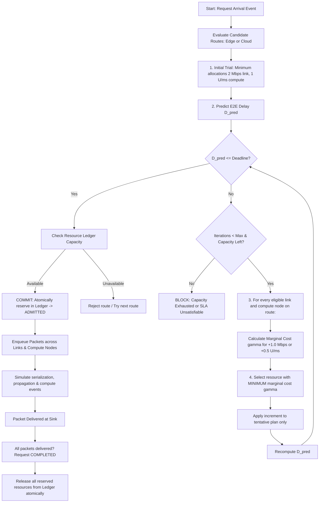

# MCRA Architecture, Execution Flow & File Breakdown

> **Primary Reference:**  
> Jia-You Lin, Ping-Hung Chou, and Ren-Hung Hwang,  
> *"Dynamic Resource Allocation for Network Slicing with Multi-Tenants in 5G Two-Tier Networks,"*  
> **Sensors**, 23(10), 4698 (2023). [DOI: 10.3390/s23104698](https://doi.org/10.3390/s23104698).

---

## 1. What is MCRA & Why Does It Exist?

Traditional 5G slicing often uses:
1. **Static Allocation:** Hard-coded slices (e.g. 50% eMBB, 30% URLLC, 20% mMTC). This wastes bandwidth when traffic is idle and fails during bursts.
2. **Round Robin:** Equal sharing of leftovers, but blind to delay deadlines (treats YouTube traffic the same as autonomous vehicle emergency brakes).
3. **Priority QoS Heuristic:** Gives bandwidth to whatever failed last second, but lacks a cost-optimized multi-tier (Edge + Cloud) framework.

**MCRA (Minimum Cost Resource Allocation)** solves resource allocation across a **two-tier network (Edge MEC + Central Cloud)** by treating resource assignment as an **economic optimization problem**:
* Every link (bandwidth) and server (CPU/compute) has a capacity $M$ and current usage $u$.
* As usage increases, the cost to reserve more resources grows exponentially.
* When a packet/request arrives and its predicted delay violates its deadline, MCRA doesn't guess where to put resources. It mathematically calculates the **Marginal Cost ($\gamma$)** of adding a small increment on every candidate link or compute node, picks the **cheapest** option, and re-checks the latency.
* It repeats this until the latency requirement is satisfied, or drops/blocks the request cleanly if capacity is exhausted (with zero resource leaks).

---

## 2. Core Mathematical Equations

### A. Exponential Cost Function
The cost $C(u)$ of occupying $u$ units on a resource with maximum capacity $M$:
$$C(u) = \delta^{\left(\frac{u}{M} - 1\right)}$$
* $\delta > 1.0$ is the **cost base** (default: `2.0`).
* When empty ($u = 0$): $C(0) = \delta^{-1} = 0.5$.
* When full ($u = M$): $C(M) = \delta^0 = 1.0$.
* Strictly convex: heavily utilized nodes become exponentially expensive to allocate onto.

### B. Marginal Cost of an Increment ($\Delta u$)
The incremental cost $\gamma(u, \Delta u, M)$ of adding $\Delta u$ units:
$$\gamma(u, \Delta u, M) = C(u + \Delta u) - C(u) = \delta^{\left(\frac{u + \Delta u}{M} - 1\right)} - \delta^{\left(\frac{u}{M} - 1\right)}$$
* MCRA picks: $\arg\min_{X \in \text{Eligible}} \gamma^X$.

### C. End-to-End Delay Model
$$D_{E2E} = D_{queue} + \sum_{\text{links}} (D_{\text{ser}} + D_{\text{prop}}) + D_{\text{compute}}$$
* **Serialization Delay:** $D_{\text{ser}} = \frac{\text{payload bits}}{\text{bandwidth (Mbps)} \times 1,000} \text{ (ms)}$
* **Propagation Delay:** Physical link travel time (e.g., access = 0.5 ms, backhaul = 12.0 ms).
* **Compute Delay:** $D_{\text{compute}} = \frac{\text{compute demand}}{\text{compute rate (units/ms)}} + \text{base delay (ms)}$

---

## 3. End-to-End Simulation Flow

The discrete-event MCRA engine executes in continuous simulated time (milliseconds).



---

## 4. File-by-File Breakdown: What Each File Does

Every MCRA module is completely isolated in `mcra/` and `allocators/`:

| File | Primary Role & Responsibilities |
|---|---|
| **`allocators/mcra_allocator.py`** | **The Pure Math Engine:** Implements `node_exponential_cost()` and `marginal_cost()`. Enforces strict convexity and guards against capacity overbooking ($u + \Delta u \le M$). |
| **`mcra/models.py`** | **Data Structures:** Immutable dataclasses & Enums. Defines `ServiceRequest`, `Packet`, `CommunicationLink`, `ComputeNode`, `Route`, `SimulationEvent`, `MCRADecisionTrace`, and slice QoS thresholds. |
| **`mcra/resources.py`** | **The Atomic Ledger:** Single source of truth for link bandwidths and CPU capacities. Guarantees all-or-nothing reservations, zero capacity leakage on failure, idempotent release, and time-weighted utilization. |
| **`mcra/latency.py`** | **Physical Delay Calculator:** Enforces standard units ($1\text{ Mbps} = 1,000\text{ bits/ms}$). Computes link serialization, propagation delay, and server compute delay. |
| **`mcra/topology.py`** | **Network Graph:** Assembles the two-tier 5G network: UEs $\to$ Access Link $\to$ Edge Router $\to$ [MEC Edge (30 U/ms) OR Core Backhaul $\to$ Central Cloud (150 U/ms)] $\to$ Destination Sink. Generates legal candidate routes. |
| **`mcra/allocator.py`** | **The Decision Loop:** Orchestrates `admit_request()`. Tests initial minimums, runs the iterative lowest-marginal-cost loop, records decision traces (`AllocationStepTrace`), and commits reservations. |
| **`mcra/event_engine.py`** | **Discrete-Event Scheduler:** Priority queue ordered by `(time_ms, sequence)`. Dispatches events (`REQUEST_ARRIVAL`, `LINK_SERVICE_COMPLETED`, `COMPUTE_SERVICE_COMPLETED`, `PACKET_DELIVERED`, `RESOURCE_RELEASED`). |
| **`mcra/queues.py`** | **Queueing Disciplines:** Finite-buffer FIFO queues on each link and compute node. Measures queue wait times and records buffer overflow drops (`QUEUE_OVERFLOW_DROP`). |
| **`mcra/traffic.py`** | **Traffic & Trace Replayer:** Generates requests for 8 synthetic scenarios (eMBB surge, URLLC emergency, etc.) and includes `TraceReplayer` to ingest real commercial 5G NR CSV traces and NS-3 ASCII trace logs. |
| **`mcra/metrics.py`** | **Analytics Engine:** Derives all metrics from actual event logs: request blocking probability, throughput, E2E mean/P95 latency, deadline success ratio, and per-tenant/slice SLAs. |
| **`mcra/simulation.py`** | **Master Orchestrator:** Glues topology, ledger, traffic generator, allocator, and event engine together into a clean `run()` method. |
| **`mcra/serialization.py`** | **Data Sanitizer:** Eliminates NaN/Infinities for JSON compatibility and formats request logs into CSV rows. |
| **`data/traces/`** | **Empirical Datasets:** Bundles 4 trace files: `5g_nr_embb_video.csv`, `5g_nr_urllc_telemetry.csv`, `5g_nr_mmtc_smartgrid.csv`, and `ns3_ascii_trace_sample.txt`. |
| **`dashboard/app.py`** | **Flask Backend:** Exposes the isolated `@app.route('/api/mcra/simulate')` endpoint and additively routes `algorithm: "mcra"`. |
| **`dashboard/templates/index.html`** | **Interactive Web UI:** Displays live two-tier topology utilization bars, step-by-step decision inspector, event timeline, and latency charts. |
| **`main.py`** | **CLI Entry Point:** Allows running MCRA directly via terminal (`python main.py --algorithm mcra --scenario trace_playback`). |
| **`tests/test_mcra_*.py`** | **Verification Suite:** 29 automated tests verifying marginal cost convexity, ledger atomicity, latency sums, event ordering, reproducibility, trace playback, and legacy regression. |

---

## 5. How to Run & Verify

1. **Run Unit Tests:**
   ```powershell
   pytest tests -v
   ```
2. **Run MCRA via Command Line:**
   ```powershell
   python main.py --algorithm mcra --scenario normal_mix
   python main.py --algorithm mcra --scenario trace_playback
   ```
3. **Launch the Dashboard:**
   ```powershell
   python main.py --dashboard
   ```
   Open `http://localhost:5000`, select **"MCRA (Research Two-Tier)"**, and click **"Run Simulation"**.
