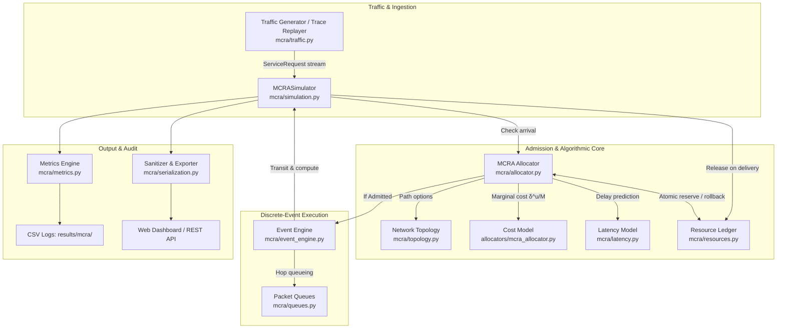
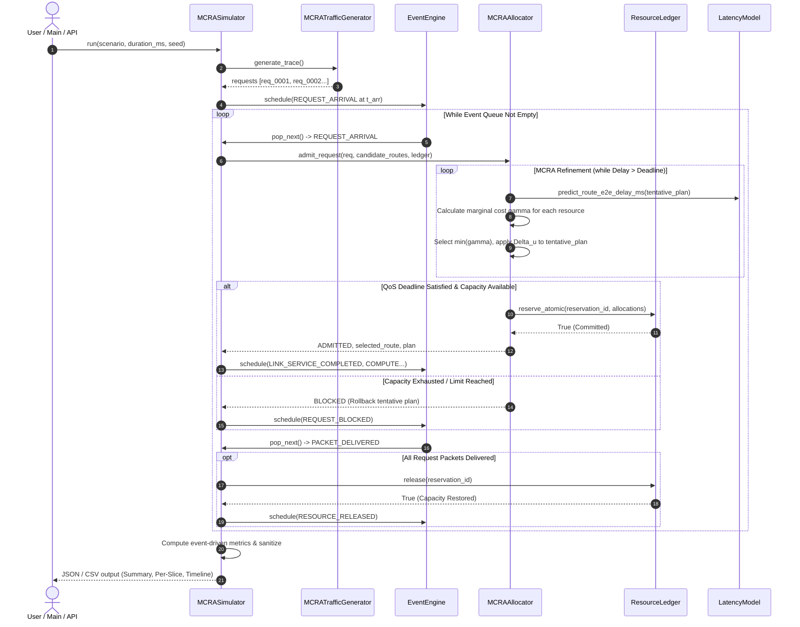
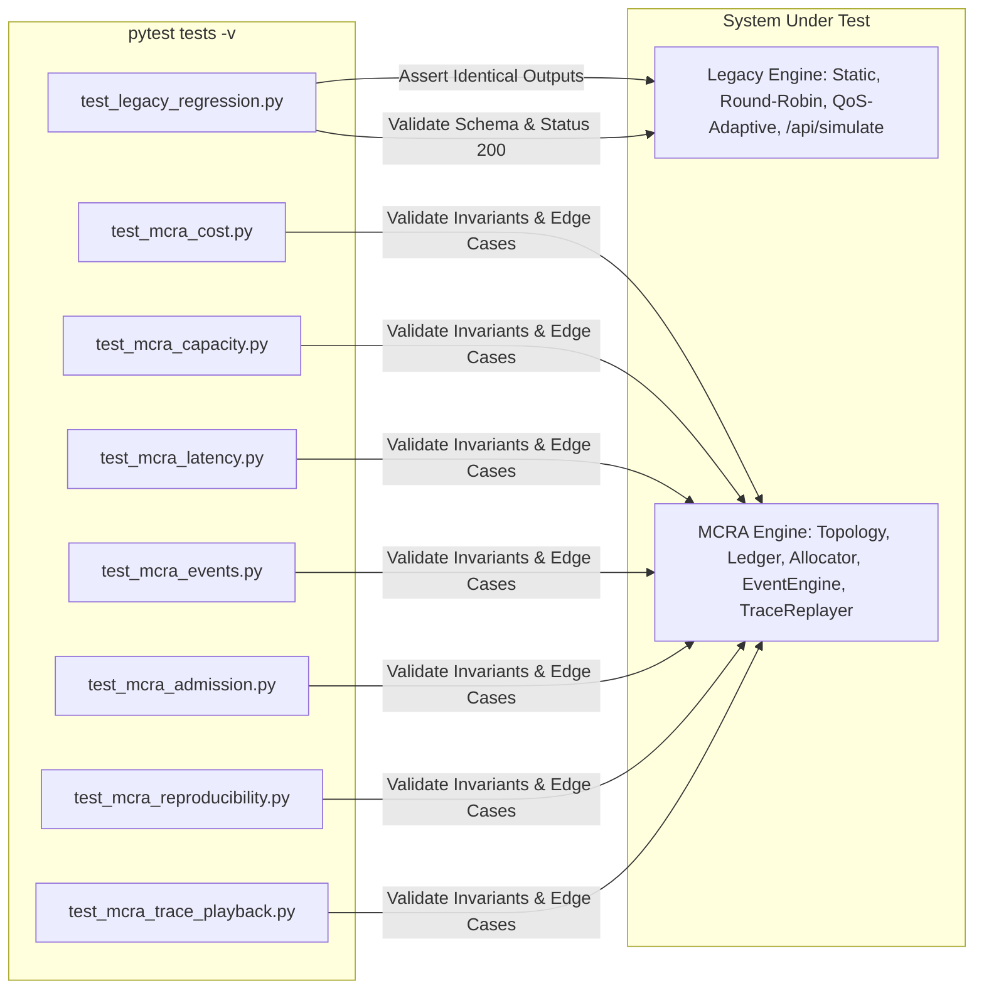
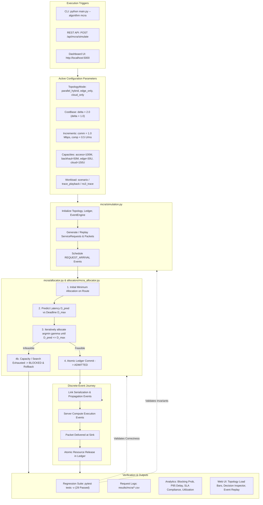

# MCRA Technical Documentation: Architecture, Workflow, Parameters & Regression

> **Authoritative Technical Reference for `mcra/` Subsystem**  
> **Academic Foundation:** Jia-You Lin, Ping-Hung Chou, and Ren-Hung Hwang, *"Dynamic Resource Allocation for Network Slicing with Multi-Tenants in 5G Two-Tier Networks,"* *Sensors*, 23(10), 4698 (2023). [DOI: 10.3390/s23104698](https://doi.org/10.3390/s23104698).

---

## 1. Overview and Architecture

### 1.1 Purpose and Problem Statement
The legacy simulator implemented three traditional 5G slicing algorithms (`Static`, `Round-Robin`, and `QoS-Adaptive`) over a global scalar bandwidth pool (default 100 Mbps) with discrete 1-second time steps. While instructive, this macroscopic model exhibited three critical theoretical limitations:
1. **Tier Blindness:** It treated bandwidth as a single aggregate pool without distinguishing radio access links, edge processing, and cloud backhaul.
2. **Resource Dimension Neglect:** Real 5G slices require **joint allocation** of communication bandwidth ($R_{comm}$) and computation processing capacity ($R_{comp}$) across two physical tiers (Mobile Edge Computing [MEC] and Central Cloud).
3. **Coarse Heuristics:** Allocation relied on static partitions or reactive penalties rather than rigorous marginal-cost optimization against strict end-to-end (E2E) latency deadlines ($D_{max}$).

The **Minimum Cost Resource Allocation (MCRA)** subsystem was introduced to resolve these limitations. It models individual service requests and packet flows navigating an explicit two-tier 5G network graph, allocating resources dynamically using convex exponential marginal costs to satisfy strict Service Level Agreements (SLAs) with zero capacity leakage.

### 1.2 Main Components and Subsystem Interactions
The `mcra/` package operates as an isolated, additive discrete-event simulation engine composed of five core subsystems:

1. **Topology & Network Subsystem (`mcra/topology.py`, `mcra/models.py`):** Defines explicit nodes (UE, Edge Router/gNB, MEC Edge, Central Cloud, Sink) and directional communication links with physical propagation delays and queue capacities.
2. **Resource Ledger Subsystem (`mcra/resources.py`):** Acts as the atomic, single source of truth for communication link bandwidth and server compute capacity, enforcing non-negative invariants, all-or-nothing reservations, and idempotent releases.
3. **Algorithmic Cost Subsystem (`allocators/mcra_allocator.py`, `mcra/allocator.py`):** Calculates convex marginal cost increments and coordinates the iterative allocation loop across candidate paths.
4. **Discrete-Event Simulation Engine (`mcra/event_engine.py`, `mcra/queues.py`, `mcra/latency.py`):** Maintains a prioritized event queue ordered by `(time_ms, sequence)`, advancing simulation time monotonically as packets serialize, propagate, and process.
5. **Traffic & Measurement Subsystem (`mcra/traffic.py`, `mcra/metrics.py`, `mcra/serialization.py`):** Generates reproducible synthetic stochastic traffic or replays real-world commercial 5G NR / NS-3 ASCII packet traces, deriving metrics strictly from verified event logs.



---

## 2. End-to-End Execution Flow

### 2.1 Main Entry Points
MCRA execution can be triggered via three entry points:
* **Command Line Interface (CLI):** [`main.py`](file:///c:/Users/vivek/OneDrive/Desktop/CN/cn%20lab%20project/main.py) via `--algorithm mcra`.
* **REST API:** [`dashboard/app.py`](file:///c:/Users/vivek/OneDrive/Desktop/CN/cn%20lab%20project/dashboard/app.py) via `POST /api/mcra/simulate` or `POST /api/simulate` (`{"algorithm": "mcra"}`).
* **Interactive Web UI:** [`dashboard/templates/index.html`](file:///c:/Users/vivek/OneDrive/Desktop/CN/cn%20lab%20project/dashboard/templates/index.html) under the "MCRA (Research Two-Tier)" dashboard panel.

### 2.2 Chronological Execution Lifecycle
The execution sequence proceeds in seven distinct phases:

#### Phase 1: Initialization and Ledger Registration
1. `MCRASimulator.__init__()` configures topology parameters (access capacity, backhaul capacity, edge compute, cloud compute, cost base $\delta$, increments $\Delta u$, queue limits).
2. `MCRASimulator.run()` instantiates `NetworkTopology`.
3. `ResourceLedger` is instantiated. All physical links (`link_access`, `link_edge`, `link_edge_sink`, `link_backhaul`, `link_cloud_sink`) and compute nodes (`edge_compute`, `cloud_compute`) are registered into `ledger.resources` with initial capacity $M$ and current usage $u = 0$.

#### Phase 2: Workload Ingestion (Synthetic or Empirical Trace)
`MCRATrafficGenerator.generate_trace()` is invoked:
* **Synthetic Scenarios:** Generates requests over 50 ms Poisson intervals with profile distributions for eMBB (large payloads, high throughput), URLLC (small payloads, strict deadline $\le 8$ ms), and mMTC (tiny payloads, relaxed deadline $\le 150$ ms).
* **Trace Playback (`trace_playback` / `ns3_trace`):** `TraceReplayer` ingests real CSV traces (`data/traces/5g_nr_*.csv`) or NS-3 ASCII trace logs (`ns3_ascii_trace_sample.txt`), converting physical packet timestamps and lengths into `ServiceRequest` instances.
* Requests are segmented into `Packet` objects (capped at MTU: 12,000 bits / 1,500 bytes) and sorted chronologically by `arrival_time_ms`.

#### Phase 3: Event Scheduling
For every request, an event of type `REQUEST_ARRIVAL` is scheduled into `EventEngine` at timestamp $t = r.\text{arrival\_time\_ms}$.

#### Phase 4: Event Processing & MCRA Admission Loop
The simulator enters `while engine.has_events():`, popping `(time_ms, sequence, event)` from the priority queue:
1. When `event.event_type == REQUEST_ARRIVAL`, the request is passed to `MCRAAllocator.admit_request()`.
2. Candidate routes are fetched from topology based on `TopologyMode`:
   * `EDGE_ONLY`: Candidate = `[route_edge]` (Access $\to$ Edge Link $\to$ MEC Compute $\to$ Edge Sink).
   * `CLOUD_ONLY`: Candidate = `[route_cloud]` (Access $\to$ Backhaul $\to$ Cloud Compute $\to$ Cloud Sink).
   * `PARALLEL_HYBRID`: Candidates = `[route_edge, route_cloud]`.
3. For each candidate route, `_evaluate_route()` executes:
   * **Step A (Initial Minimum Allocation):** Allocates tentative base units (e.g. 2.0 Mbps per link, 1.0 unit compute). Verifies if ledger has sufficient remaining capacity.
   * **Step B (Predicted Latency Check):** Calls `predict_route_e2e_delay_ms()`.
   * **Step C (Iterative Marginal-Cost Refinement):** While $D_{pred} > D_{max}$ and $\text{iteration} < \text{max\_iterations}$:
     * Identifies all path resources with remaining capacity $\ge \Delta u$.
     * Calculates marginal cost $\gamma(u, \Delta u, M) = \delta^{((u+\Delta u)/M - 1)} - \delta^{(u/M - 1)}$ for each candidate.
     * Selects the resource with the lowest $\gamma$ (tie-breaking: computation preferred, then alphabetical).
     * Applies the increment $\Delta u$ to the tentative plan, recomputes $D_{pred}$, and logs step trace.
   * **Step D (Commit or Reject):**
     * If $D_{pred} \le D_{max}$: Calls `ledger.reserve_atomic()`. If committed, status becomes `ADMITTED`.
     * If capacity exhausts or search limit is reached: Returns structured status (`BLOCKED_CAPACITY`, `BLOCKED_QOS_UNSATISFIABLE`, or `BLOCKED_SEARCH_LIMIT`). Tentative allocations discard immediately without touching the ledger (rollback guarantee).

#### Phase 5: Packet Transmission & Multi-Hop Traversal
If admitted:
1. `REQUEST_ADMITTED` is logged.
2. For each packet, transmission is scheduled across `route.links[0]` (`link_access`).
3. Serialization delay $D_{ser} = \frac{L_{bits}}{R_{link} \times 1,000}$ and physical propagation delay $D_{prop}$ determine completion timestamp.
4. Server serialization guarantees non-overlapping transmission via `link_busy_until` and `compute_busy_until`.
5. Upon hop completion, `LINK_SERVICE_COMPLETED` triggers forwarding to the intermediate link, then to `COMPUTE_SERVICE_COMPLETED` on the processing node, and finally to the sink link.

#### Phase 6: Delivery & Atomic Resource Release
1. Upon reaching the sink, `PACKET_DELIVERED` is scheduled.
2. When all packets for a parent request are delivered:
   * Request status transitions to `COMPLETED`.
   * Actual latency is recorded: $D_{actual} = t_{completion} - t_{arrival}$.
   * `ledger.release(reservation_id, current_t)` releases link bandwidth and compute capacity atomically.
   * `RESOURCE_RELEASED` event is logged.

#### Phase 7: Post-Simulation Metric Computation
`MCRAMetricsEngine.compute_all_metrics()` processes the completed event log and request list to compute exact time-weighted resource utilizations, blocking probabilities, percentile delays (Mean, Median, P95, P99), and per-slice SLA compliance. Results are sanitized against NaN/Infinities via `mcra/serialization.py`.



---

## 3. MCRA File and Module Summary

| File Path | Primary Responsibility | Role in Overall Workflow | Key Dependencies / Interactions |
|---|---|---|---|
| [`mcra/__init__.py`](file:///c:/Users/vivek/OneDrive/Desktop/CN/cn%20lab%20project/mcra/__init__.py) | Package initialization | Marks `mcra` as an importable Python module; defines package version metadata. | None |
| [`mcra/models.py`](file:///c:/Users/vivek/OneDrive/Desktop/CN/cn%20lab%20project/mcra/models.py) | Domain entities & data contracts | Defines Enums (`SliceType`, `TopologyMode`, `RequestStatus`, `EventType`, `ResourceType`, `NodeTier`) and Dataclasses (`ServiceRequest`, `Packet`, `CommunicationLink`, `ComputeNode`, `Route`, `SimulationEvent`, `MCRADecisionTrace`, `AllocationStepTrace`, `QoSProfile`). | Core contract used by all `mcra/` files; no external dependencies. |
| [`mcra/resources.py`](file:///c:/Users/vivek/OneDrive/Desktop/CN/cn%20lab%20project/mcra/resources.py) | Atomic resource capacity ledger | Manages registration, reservation, and release of bandwidth and compute. Enforces non-negative capacity bounds and computes time-weighted integration of utilization over time. | Depends on `models.ResourceType`. Interacts with `allocator.py` (atomic reserve) and `simulation.py` (release on delivery). |
| [`mcra/latency.py`](file:///c:/Users/vivek/OneDrive/Desktop/CN/cn%20lab%20project/mcra/latency.py) | Physical delay calculation & unit conversion | Enforces physical unit conversions ($1\text{ Mbps} = 1,000\text{ bits/ms}$). Computes transmission/serialization delay, propagation delay, compute delay, and predicts E2E route latency. | Depends on `models.CommunicationLink`, `ComputeNode`, `Route`. Invoked by `allocator.py` during refinement and `simulation.py` during traversal. |
| [`mcra/topology.py`](file:///c:/Users/vivek/OneDrive/Desktop/CN/cn%20lab%20project/mcra/topology.py) | Network graph construction | Instantiates physical entities (UE, Edge Router, MEC Node, Cloud Node, Destination) and interconnecting links. Builds candidate routes for Edge-Only, Cloud-Only, and Parallel-Hybrid modes. | Depends on `models.CommunicationLink`, `ComputeNode`, `Route`, `TopologyMode`. Invoked by `simulation.py` during setup. |
| [`mcra/event_engine.py`](file:///c:/Users/vivek/OneDrive/Desktop/CN/cn%20lab%20project/mcra/event_engine.py) | Priority-queue event scheduler | Implements discrete-event priority queue ordered by `(time_ms, sequence)`. Guarantees reproducible, monotonically increasing clock progression without wall-clock sleeps. | Depends on `models.SimulationEvent`, `EventType`. Driven directly by `simulation.py`. |
| [`mcra/queues.py`](file:///c:/Users/vivek/OneDrive/Desktop/CN/cn%20lab%20project/mcra/queues.py) | Link and compute buffer queues | Implements FIFO packet buffers with finite queue capacity. Tracks enqueue, dequeue, waiting times, and buffer overflow drop events. | Depends on `models.Packet`. Interacts with `simulation.py` for queue metrics. |
| [`mcra/traffic.py`](file:///c:/Users/vivek/OneDrive/Desktop/CN/cn%20lab%20project/mcra/traffic.py) | Workload generation & trace replay | Implements `MCRATrafficGenerator` for stochastic scenario profiles and `TraceReplayer` for ingesting real commercial 5G NR CSV traces and NS-3 ASCII packet traces. | Depends on `models.ServiceRequest`, `Packet`, `SliceType`, `QoSProfile`. Ingests files from `data/traces/`. |
| [`mcra/allocator.py`](file:///c:/Users/vivek/OneDrive/Desktop/CN/cn%20lab%20project/mcra/allocator.py) | MCRA decision loop facade | Executes candidate path selection, initial allocation trials, iterative marginal-cost increments, SLA checking, and atomic ledger commitments. | Depends on `models`, `resources.ResourceLedger`, `latency`, and `allocators.mcra_allocator.marginal_cost`. |
| [`mcra/metrics.py`](file:///c:/Users/vivek/OneDrive/Desktop/CN/cn%20lab%20project/mcra/metrics.py) | Simulation analytics & QoS auditing | Computes request-level (blocking probability, completion ratio), packet-level (throughput, PDR), per-slice SLAs, per-tenant metrics, and MCRA diagnostic iterations from verified event logs. | Depends on `models.ServiceRequest`, `Packet`, `RequestStatus`, `SliceType`, and `resources.ResourceLedger`. |
| [`mcra/simulation.py`](file:///c:/Users/vivek/OneDrive/Desktop/CN/cn%20lab%20project/mcra/simulation.py) | Master simulation orchestration | Connects topology, ledger, traffic generator, event engine, allocator, and metrics into a unified `run()` method. Orchestrates multi-hop packet flow and resource lifecycles. | Imports all other `mcra/` modules, returning a fully sanitized JSON output dictionary. |
| [`mcra/serialization.py`](file:///c:/Users/vivek/OneDrive/Desktop/CN/cn%20lab%20project/mcra/serialization.py) | Data sanitization & CSV formatting | Recursively cleans simulation results to convert `NaN` and `Infinity` into JSON-safe representations; formats request logs into exportable tabular CSV rows. | Utility called by `simulation.py`. |
| [`allocators/mcra_allocator.py`](file:///c:/Users/vivek/OneDrive/Desktop/CN/cn%20lab%20project/allocators/mcra_allocator.py) | Mathematical cost module | Pure mathematical implementations of node exponential cost $C(u) = \delta^{(u/M - 1)}$ and marginal cost $\gamma(u, \Delta u, M) = C(u+\Delta u) - C(u)$. | Independent module; consumed by `mcra/allocator.py`. |

---

## 4. Core Logic and Parameter Specifications

### 4.1 Algorithmic Logic
The core decision logic inside `allocators/mcra_allocator.py` and `mcra/allocator.py` implements the convex optimization model from Lin et al. (2023):

```python
# 1. Exponential resource cost function
normalized_usage = max(0.0, min(1.0, usage / capacity))
exponent = normalized_usage - 1.0
cost = math.pow(cost_base, exponent)

# 2. Marginal cost of adding increment Delta_u
cost_before = node_exponential_cost(used_before, capacity, cost_base)
cost_after = node_exponential_cost(used_before + increment, capacity, cost_base)
marginal_cost = cost_after - cost_before
```

#### Selection Rule:
At each iteration $k$, the set of eligible resources $\mathcal{E}$ consists of all links $l \in \text{Route}$ and the compute node $c \in \text{Route}$ where adding their legal increment ($\Delta u_{comm}$ or $\Delta u_{comp}$) does not exceed the node's maximum capacity $M$ or the system ledger's remaining capacity. The selected resource $X^*$ is:
$$X^* = \arg\min_{X \in \mathcal{E}} \gamma^X(u_X, \Delta u_X, M_X, \delta)$$

#### Termination Guarantees:
* **Success:** $D_{pred} \le D_{max} \implies$ Commit atomically via `ledger.reserve_atomic()`, return `ADMITTED`.
* **Exhaustion:** $\mathcal{E} = \emptyset \implies$ Stop refinement, return `BLOCKED_CAPACITY`.
* **Search Limit:** $\text{iteration} \ge \text{max\_iterations} \implies$ Stop refinement, return `BLOCKED_SEARCH_LIMIT`.
* **Zero Leakage Invariant:** If admission fails, the tentative allocation dictionary is discarded. No reservation ID is issued, and `ledger.active_reservations` remains completely unmodified.

### 4.2 Comprehensive Parameter Rationale & Specifications

The table below documents every parameter within the system, categorizing its status:

| Parameter Name & Location | Status | Type & Default Value | Valid Range | Purpose & Behavioral Impact | Regression & Verification Tests |
|---|---|---|---|---|---|
| `algorithm` ([`main.py`](file:///c:/Users/vivek/OneDrive/Desktop/CN/cn%20lab%20project/main.py#L18), [`dashboard/app.py`](file:///c:/Users/vivek/OneDrive/Desktop/CN/cn%20lab%20project/dashboard/app.py#L86)) | **Modified** | `str = "all"` | `["all", "static", "round_robin", "qos_adaptive", "mcra"]` | Selects resource allocation engine. Specifying `"mcra"` dispatches to `MCRASimulator` while preserving legacy paths for old options. | [`tests/test_legacy_regression.py`](file:///c:/Users/vivek/OneDrive/Desktop/CN/cn%20lab%20project/tests/test_legacy_regression.py) |
| `topology_mode` ([`mcra/simulation.py`](file:///c:/Users/vivek/OneDrive/Desktop/CN/cn%20lab%20project/mcra/simulation.py#L35)) | **New** | `TopologyMode = PARALLEL_HYBRID` | `["edge_only", "cloud_only", "parallel_hybrid"]` | Determines candidate paths for requests. `parallel_hybrid` allows MEC edge execution with fallback to central cloud. | [`tests/test_mcra_admission.py`](file:///c:/Users/vivek/OneDrive/Desktop/CN/cn%20lab%20project/tests/test_mcra_admission.py) |
| `cost_base` ($\delta$) ([`allocators/mcra_allocator.py`](file:///c:/Users/vivek/OneDrive/Desktop/CN/cn%20lab%20project/allocators/mcra_allocator.py#L17)) | **New** | `float = 2.0` | $\delta > 1.0$ | Base of the exponential cost function. Higher values increase penalty on heavily loaded nodes, aggressively forcing load-balancing. | [`tests/test_mcra_cost.py`](file:///c:/Users/vivek/OneDrive/Desktop/CN/cn%20lab%20project/tests/test_mcra_cost.py) |
| `comm_increment_mbps` ([`mcra/allocator.py`](file:///c:/Users/vivek/OneDrive/Desktop/CN/cn%20lab%20project/mcra/allocator.py#L34)) | **New** | `float = 1.0` | $> 0$ Mbps | Discrete bandwidth increment $\Delta u_{comm}$ evaluated per MCRA iteration. Smaller values allow finer optimization at the cost of more iterations. | [`tests/test_mcra_admission.py`](file:///c:/Users/vivek/OneDrive/Desktop/CN/cn%20lab%20project/tests/test_mcra_admission.py) |
| `compute_increment_units` ([`mcra/allocator.py`](file:///c:/Users/vivek/OneDrive/Desktop/CN/cn%20lab%20project/mcra/allocator.py#L35)) | **New** | `float = 0.5` | $> 0$ Units/ms | Discrete compute rate increment $\Delta u_{comp}$ evaluated per MCRA iteration for MEC/Cloud servers. | [`tests/test_mcra_admission.py`](file:///c:/Users/vivek/OneDrive/Desktop/CN/cn%20lab%20project/tests/test_mcra_admission.py) |
| `access_link_capacity_mbps` ([`mcra/topology.py`](file:///c:/Users/vivek/OneDrive/Desktop/CN/cn%20lab%20project/mcra/topology.py#L22)) | **New** | `float = 100.0` | $> 0$ Mbps | Maximum physical capacity of the radio access link connecting UEs to the Edge Router (gNB). | [`tests/test_mcra_capacity.py`](file:///c:/Users/vivek/OneDrive/Desktop/CN/cn%20lab%20project/tests/test_mcra_capacity.py) |
| `backhaul_capacity_mbps` ([`mcra/topology.py`](file:///c:/Users/vivek/OneDrive/Desktop/CN/cn%20lab%20project/mcra/topology.py#L23)) | **New** | `float = 50.0` | $> 0$ Mbps | Maximum physical capacity of the core backhaul link connecting Edge Router to Central Cloud. | [`tests/test_mcra_capacity.py`](file:///c:/Users/vivek/OneDrive/Desktop/CN/cn%20lab%20project/tests/test_mcra_capacity.py) |
| `edge_compute_capacity` ([`mcra/topology.py`](file:///c:/Users/vivek/OneDrive/Desktop/CN/cn%20lab%20project/mcra/topology.py#L24)) | **New** | `float = 30.0` | $> 0$ Units/ms | Total compute processing capacity of the local MEC Edge node. | [`tests/test_mcra_capacity.py`](file:///c:/Users/vivek/OneDrive/Desktop/CN/cn%20lab%20project/tests/test_mcra_capacity.py) |
| `cloud_compute_capacity` ([`mcra/topology.py`](file:///c:/Users/vivek/OneDrive/Desktop/CN/cn%20lab%20project/mcra/topology.py#L25)) | **New** | `float = 150.0` | $> 0$ Units/ms | Total compute processing capacity of the high-performance Central Cloud data center. | [`tests/test_mcra_capacity.py`](file:///c:/Users/vivek/OneDrive/Desktop/CN/cn%20lab%20project/tests/test_mcra_capacity.py) |
| `max_iterations` ([`mcra/allocator.py`](file:///c:/Users/vivek/OneDrive/Desktop/CN/cn%20lab%20project/mcra/allocator.py#L36)) | **New** | `int = 50` | $\ge 1$ | Upper bound on refinement increments per request before halting with `BLOCKED_SEARCH_LIMIT`. | [`tests/test_mcra_admission.py`](file:///c:/Users/vivek/OneDrive/Desktop/CN/cn%20lab%20project/tests/test_mcra_admission.py) |
| `duration_ms` ([`mcra/simulation.py`](file:///c:/Users/vivek/OneDrive/Desktop/CN/cn%20lab%20project/mcra/simulation.py#L53)) | **New** | `float = 1000.0` | $1.0$ to $30000.0$ ms | Temporal observation duration for the discrete-event clock. | [`tests/test_mcra_events.py`](file:///c:/Users/vivek/OneDrive/Desktop/CN/cn%20lab%20project/tests/test_mcra_events.py) |
| `queue_capacity_packets` ([`mcra/queues.py`](file:///c:/Users/vivek/OneDrive/Desktop/CN/cn%20lab%20project/mcra/queues.py#L19)) | **New** | `int = 200` | $\ge 1$ | Buffer size per link/compute queue. Overflows trigger `QUEUE_OVERFLOW_DROP`. | [`tests/test_mcra_events.py`](file:///c:/Users/vivek/OneDrive/Desktop/CN/cn%20lab%20project/tests/test_mcra_events.py) |
| `scenario` ([`main.py`](file:///c:/Users/vivek/OneDrive/Desktop/CN/cn%20lab%20project/main.py#L17)) | **Modified** | `str = "dynamic"` (legacy) / `"normal_mix"` (MCRA) | `[normal, heavy_embb, ...] + [normal_mix, embb_surge, ..., trace_playback, ns3_trace]` | Extended to accept 8 MCRA-specific scenarios and empirical trace playback modes while preserving legacy scenario handling. | [`tests/test_mcra_trace_playback.py`](file:///c:/Users/vivek/OneDrive/Desktop/CN/cn%20lab%20project/tests/test_mcra_trace_playback.py) |
| `bandwidth` ([`config/config.py`](file:///c:/Users/vivek/OneDrive/Desktop/CN/cn%20lab%20project/config/config.py#L4)) | **Unchanged** | `float = 100.0` | $> 0$ Mbps | Global total bandwidth used by legacy macroscopic simulator (`Simulator`). | [`tests/test_legacy_regression.py`](file:///c:/Users/vivek/OneDrive/Desktop/CN/cn%20lab%20project/tests/test_legacy_regression.py) |
| `duration` ([`config/config.py`](file:///c:/Users/vivek/OneDrive/Desktop/CN/cn%20lab%20project/config/config.py#L5)) | **Unchanged** | `int = 60` | $> 0$ seconds | Total duration in seconds for legacy macroscopic simulation. | [`tests/test_legacy_regression.py`](file:///c:/Users/vivek/OneDrive/Desktop/CN/cn%20lab%20project/tests/test_legacy_regression.py) |
| `SLICE_CONFIG` ([`config/config.py`](file:///c:/Users/vivek/OneDrive/Desktop/CN/cn%20lab%20project/config/config.py#L9)) | **Unchanged** | `dict` | Fixed dictionary | Priority, min_bw, max_bw, latency_req, packet_loss_req for legacy slices. | [`tests/test_legacy_regression.py`](file:///c:/Users/vivek/OneDrive/Desktop/CN/cn%20lab%20project/tests/test_legacy_regression.py) |

---

## 5. Regression Testing: Architecture, Verification, and Results

### 5.1 Purpose of Regression Testing in MCRA
When introducing an advanced multi-tier optimization engine like MCRA, the primary regression risk is **silent corruption of legacy behavior**:
* Refactoring shared entry points (`app.py`, `main.py`) might break legacy query parameter parsing.
* Modifying simulation models might inadvertently alter the mathematical results of `StaticAllocator`, `RoundRobinAllocator`, or `QoSAllocator`.
* Schema drifts in JSON API responses might crash legacy dashboard UI charts.

To eliminate this risk, regression testing enforces **strict architectural isolation**: MCRA operates in separate modules (`mcra/` and `allocators/`), leaving legacy modules (`allocation/`, `models/`, `simulation/simulator.py`) 100% untouched.



### 5.2 Test Suite Structure and Assertion Logic
The test suite consists of 8 dedicated test modules totaling **29 automated tests**:

1. **`tests/test_legacy_regression.py` (4 tests):**
   * `test_legacy_allocator_instantiation_and_names`: Confirms legacy allocators instantiate with original names (`"Static"`, `"Round Robin"`, `"QoS Adaptive"`).
   * `test_legacy_simulator_deterministic_run`: Runs legacy `Simulator` with fixed seed 42 and asserts DataFrame output contains expected columns (`throughput`, `latency`, `packet_loss`, `qos_satisfied`) and all 3 slice types.
   * `test_legacy_api_simulate_endpoint`: Posts `{"algorithm": "all"}` to `/api/simulate` and verifies status 200, matching output schema keys (`results`, `summary`, `comparison`), and non-empty algorithm summaries.
   * `test_mcra_api_endpoint_validation`: Validates that `/api/mcra/simulate` returns 200 on valid inputs and returns structured HTTP 400 when invalid parameters are supplied ($\delta \le 1.0$ or $\text{duration} \le 0$).
2. **`tests/test_mcra_cost.py` (4 tests):**
   * Verifies marginal cost against hand-calculated analytical value ($C(50) - C(0) = \frac{1}{\sqrt{2}} - 0.5 \approx 0.207107$).
   * Proves convexity: $\gamma(10) < \gamma(50) < \gamma(80)$ for identical $\Delta u = 10$.
   * Rejects over-capacity requests ($u + \Delta u > M$) and invalid parameter ranges ($\delta \le 1.0$, $M \le 0$, $\Delta u \le 0$).
3. **`tests/test_mcra_capacity.py` (5 tests):**
   * Validates multi-resource atomic reservation and checks zero capacity leakage on partial failure.
   * Asserts single-release idempotency (duplicate release returns `False`).
   * Proves time-weighted integral calculation of resource utilization over time.
4. **`tests/test_mcra_latency.py` (4 tests):**
   * Verifies physical conversion: $1\text{ Mbps} = 1,000\text{ bits/ms}$.
   * Validates serialization ($D_{ser} = \frac{12000}{10 \times 1000} = 1.2\text{ ms}$) and compute delay formulas.
   * Confirms multi-hop summation across links and nodes.
5. **`tests/test_mcra_events.py` (2 tests):**
   * Validates deterministic chronological order in priority queue.
   * Asserts finite queue buffer drop tracking (`QUEUE_OVERFLOW_DROP`).
6. **`tests/test_mcra_admission.py` (3 tests):**
   * Validates admission under feasible latency budgets.
   * Verifies termination with reason code `BLOCKED_QOS_UNSATISFIABLE` or `BLOCKED_CAPACITY` under impossible deadlines ($D_{max} = 0.1\text{ ms} < D_{prop}$), asserting zero resource leakage in the ledger.
   * Verifies `BLOCKED_NO_ROUTE` handling.
7. **`tests/test_mcra_reproducibility.py` (2 tests):**
   * Asserts identical traces under identical random seeds and distinct traces under distinct seeds.
8. **`tests/test_mcra_trace_playback.py` (5 tests):**
   * Validates ingestion of CSV 5G NR traces and standard NS-3 ASCII trace formats.
   * Proves full simulation runs under `trace_playback` and `ns3_trace`.

### 5.3 Test Execution Command and Results
Executed using Python 3.12.7 and pytest 7.4.4:

```powershell
pytest tests -v
```

```text
============================= test session starts =============================
platform win32 -- Python 3.12.7, pytest-7.4.4, pluggy-1.0.0 -- C:\Users\vivek\anaconda3\python.exe
cachedir: .pytest_cache
rootdir: C:\Users\vivek\OneDrive\Desktop\CN\cn lab project
plugins: anyio-4.2.0
collecting ... collected 29 items

tests/test_legacy_regression.py::test_legacy_allocator_instantiation_and_names PASSED [  3%]
tests/test_legacy_regression.py::test_legacy_simulator_deterministic_run PASSED [  6%]
tests/test_legacy_regression.py::test_legacy_api_simulate_endpoint PASSED [ 10%]
tests/test_legacy_regression.py::test_mcra_api_endpoint_validation PASSED [ 13%]
tests/test_mcra_admission.py::test_mcra_admission_success_under_feasible_deadline PASSED [ 17%]
tests/test_mcra_admission.py::test_mcra_blocks_impossible_qos_with_reason PASSED [ 20%]
tests/test_mcra_admission.py::test_mcra_blocks_when_no_route_available PASSED [ 24%]
tests/test_mcra_capacity.py::test_ledger_registration_and_initial_state PASSED [ 27%]
tests/test_mcra_capacity.py::test_atomic_reservation_success PASSED      [ 31%]
tests/test_mcra_capacity.py::test_atomic_reservation_rollback_on_partial_failure PASSED [ 34%]
tests/test_mcra_capacity.py::test_single_release_and_idempotence PASSED  [ 37%]
tests/test_mcra_capacity.py::test_time_weighted_utilization PASSED       [ 41%]
tests/test_mcra_cost.py::test_marginal_cost_hand_calculated_example PASSED [ 44%]
tests/test_mcra_cost.py::test_marginal_cost_convexity_increase PASSED    [ 48%]
tests/test_mcra_cost.py::test_marginal_cost_rejects_over_capacity PASSED [ 51%]
tests/test_mcra_cost.py::test_marginal_cost_rejects_invalid_parameters PASSED [ 55%]
tests/test_mcra_events.py::test_event_engine_chronological_ordering PASSED [ 58%]
tests/test_mcra_events.py::test_packet_queue_finite_overflow_drops PASSED [ 62%]
tests/test_mcra_latency.py::test_unit_conversion_mbps_to_bits_per_ms PASSED [ 65%]
tests/test_mcra_latency.py::test_serialization_delay_calculation PASSED  [ 68%]
tests/test_mcra_latency.py::test_compute_delay_calculation PASSED        [ 72%]
tests/test_mcra_latency.py::test_end_to_end_route_delay_sum PASSED       [ 75%]
tests/test_mcra_reproducibility.py::test_fixed_seed_reproducible_traces PASSED [ 79%]
tests/test_mcra_reproducibility.py::test_different_seeds_produce_different_traces PASSED [ 82%]
tests/test_mcra_trace_playback.py::test_load_csv_trace PASSED            [ 86%]
tests/test_mcra_trace_playback.py::test_load_ns3_ascii_trace PASSED      [ 89%]
tests/test_mcra_trace_playback.py::test_load_combined_5g_nr_traces_chronological_order PASSED [ 93%]
tests/test_mcra_trace_playback.py::test_simulation_with_trace_playback_scenario PASSED [ 96%]
tests/test_mcra_trace_playback.py::test_simulation_with_ns3_trace_scenario PASSED [100%]

============================= 29 passed in 2.79s =============================
```

---

## 6. System Changes and Architecture Summary

### 6.1 Baseline vs. MCRA Implementation Comparison
Comparing Git commit `9ffd3c2` (baseline) with commit `8865c10` (MCRA integration):

| Architectural Dimension | Baseline Implementation (`9ffd3c2`) | Current MCRA Implementation (`8865c10`) |
|---|---|---|
| **Network Model** | Flat scalar bandwidth pool (100 Mbps) with no network graph or physical hops. | Explicit two-tier physical graph: Radio Access Link $\to$ Edge Router $\to$ [MEC Node / Backhaul $\to$ Cloud] $\to$ Sink. |
| **Resource Dimensions** | Communication bandwidth only. | Joint allocation of communication bandwidth ($R_{comm}$) and computation processing units ($R_{comp}$). |
| **Temporal Granularity** | Discrete 1-second bulk time steps. | Microsecond/millisecond discrete-event engine (`EventEngine`) with priority-queue scheduling. |
| **Latency Modeling** | Empirical synthetic heuristic: $\text{base} \times (1 + 2 \times \text{load})$. | Exact sum of queue delay, link serialization delay, physical propagation delay, and compute service delay. |
| **Allocation Mechanism** | Static shares, Round-Robin equal distribution, or priority score heuristics. | Iterative economic marginal-cost minimization: $\gamma = \delta^{(u/M - 1)}$ until SLA deadline is satisfied. |
| **Admission & Blocking** | Over-demands result in calculated packet loss percentage; requests are not blocked. | Strict admission control: requests meeting SLA are admitted atomically; unfulfillable requests are blocked with explicit reason codes. |
| **Empirical Trace Replay** | None (purely synthetic formulaic traffic). | Native `TraceReplayer` supporting commercial 5G NR CSV traces and NS-3 ASCII packet traces. |
| **Legacy Compatibility** | Original baseline algorithms active. | 100% backward-compatible: original allocators, routes, and tests remain intact and verified. |

### 6.2 Consolidated End-to-End System Diagram


