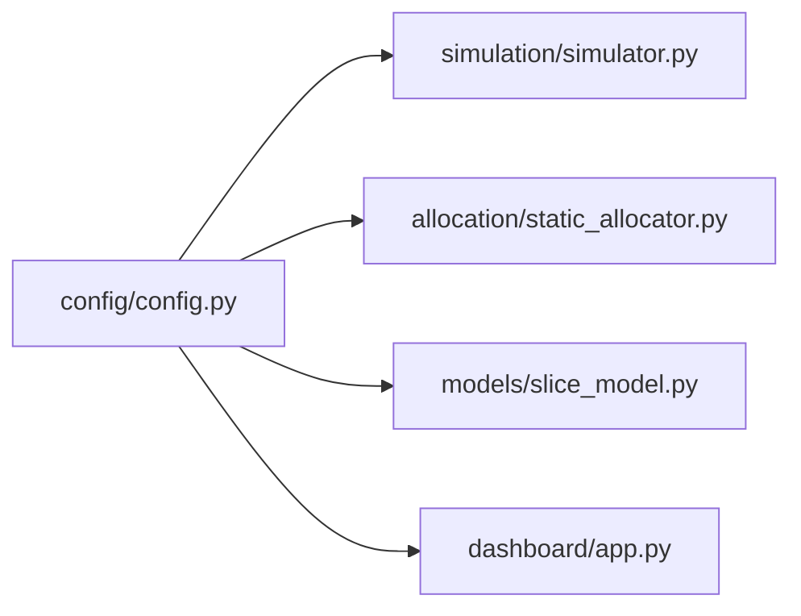

# Module Documentation: `config/`

## 1. Overview
The `config/` directory provides centralized configuration and system constants for the 5G Network Slicing Simulator. By separating configuration from execution logic, the system allows easy parameter tuning without modifying core algorithmic code.

---

## 2. File Deep-Dive: `config/config.py`

### 2.1. File Purpose
Contains all global simulation parameters, slice QoS contracts (SLAs), static allocation ratios, and base physical latency constants.

### 2.2. Constants Breakdown

#### Global Simulation Constants
*   `TOTAL_BANDWIDTH = 100`: Total available capacity of the 5G Radio Access Network / Core link in Megabits per second (Mbps).
*   `SIM_DURATION = 60`: Number of discrete time steps (seconds) for standard simulation runs.
*   `TIME_STEP = 1`: Duration of each discrete simulation increment in seconds.

#### Slice Configuration Dictionary (`SLICE_CONFIG`)
Defines the parameters and QoS Service Level Agreement (SLA) for each of the three network slices:

```python
SLICE_CONFIG = {
    'eMBB': {
        'priority': 3,               # Moderate base priority
        'min_bw': 20,                # Minimum guaranteed bandwidth (Mbps) to prevent starvation
        'max_bw': 60,                # Maximum allocation ceiling (Mbps)
        'latency_req': 100,          # Maximum allowable latency SLA (ms)
        'packet_loss_req': 5.0,      # Maximum allowable packet loss SLA (%)
        'base_users': 20,            # Initial baseline user count
        'traffic_per_user': 2.0      # Expected bandwidth demand per user (Mbps)
    },
    'URLLC': {
        'priority': 5,               # Highest base priority (critical safety traffic)
        'min_bw': 10,                # Minimum guaranteed bandwidth (Mbps)
        'max_bw': 50,                # Maximum allocation ceiling (Mbps)
        'latency_req': 5,            # Ultra-low latency requirement (< 5 ms)
        'packet_loss_req': 1.0,      # Ultra-high reliability requirement (< 1% loss)
        'base_users': 10,            # Baseline critical user count
        'traffic_per_user': 1.0      # Expected demand per critical node (Mbps)
    },
    'mMTC': {
        'priority': 2,               # Lowest base priority
        'min_bw': 5,                 # Minimum guaranteed bandwidth (Mbps)
        'max_bw': 30,                # Maximum allocation ceiling (Mbps)
        'latency_req': 200,          # High latency tolerance (up to 200 ms)
        'packet_loss_req': 10.0,     # High loss tolerance (up to 10%)
        'base_users': 200,           # Massive number of IoT nodes
        'traffic_per_user': 0.05     # Low data rate per sensor (50 kbps)
    }
}
```

#### Static Allocation Baseline Ratios (`ALLOCATION_RATIOS`)
Used by `StaticAllocator` to split the 100 Mbps network:
*   `eMBB`: `0.50` (50 Mbps)
*   `URLLC`: `0.30` (30 Mbps)
*   `mMTC`: `0.20` (20 Mbps)
*   *Sum:* $0.50 + 0.30 + 0.20 = 1.00$ ($100\%$).

#### Physical Base Latencies (`BASE_LATENCY`)
Represents the baseline transmission + processing delay under zero network load:
*   `eMBB`: `10` ms
*   `URLLC`: `2` ms (utilizes optimized short-packet TTI / mini-slots)
*   `mMTC`: `20` ms (low-power, duty-cycled transmission processing)

---

## 3. Data Flow & Dependencies



*   **Upstream:** None (Root configuration file).
*   **Downstream:** 
    *   `simulation/simulator.py` imports `SLICE_CONFIG`, `TOTAL_BANDWIDTH`, `SIM_DURATION` to initialize the network.
    *   `models/slice_model.py` imports `BASE_LATENCY` to calculate delay.
    *   `allocation/static_allocator.py` imports `ALLOCATION_RATIOS`.
    *   `dashboard/app.py` imports default parameter values.

---

## 4. Viva / Defense Preparation Questions
1. **Q:** *Why does mMTC have a priority of 2 if it has 200 devices compared to URLLC's 10 devices?*
   * **A:** Priority in 5G slicing is governed by application criticality, not device count. URLLC carries mission-critical packets where latency $>5\text{ ms}$ can cause physical failure or loss of life, whereas mMTC IoT sensor telemetry is non-time-sensitive and delay-tolerant.
2. **Q:** *Why are minimum bandwidth guarantees ($20+10+5 = 35\text{ Mbps}$) necessary?*
   * **A:** To prevent resource starvation. Without minimum guarantees, high-priority URLLC could consume 100% of available resources during an emergency, completely knocking out eMBB and IoT connectivity. Minimum bounds ensure basic operational continuity across all slices.
