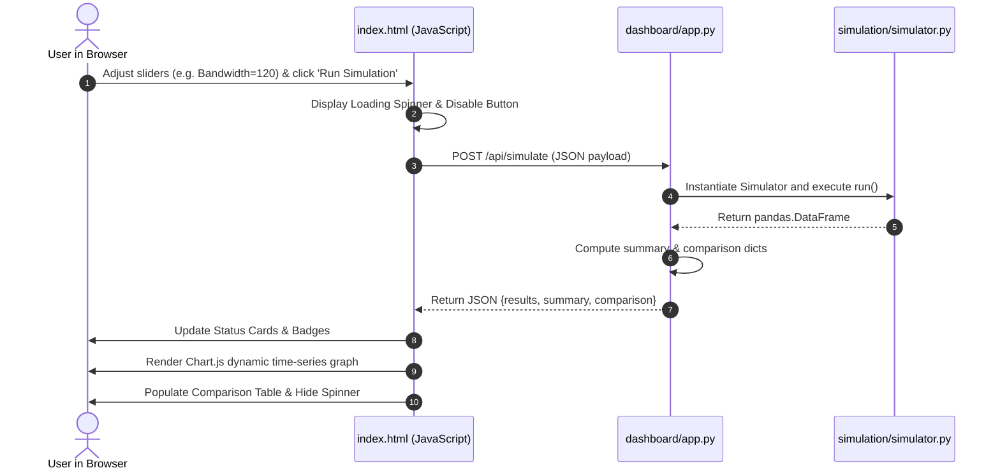

# Module Documentation: `dashboard/`

## 1. Overview
The `dashboard/` module implements a full-stack, real-time interactive Network Operations Center (NOC) simulator interface. It combines a Flask Python REST API with a responsive web dashboard utilizing HTML5, CSS3 Glassmorphism, and Chart.js.

---

## 2. File Deep-Dive

### 2.1. `dashboard/app.py` — Flask Server & REST API

#### Purpose
Acts as the bridge between browser UI interactions and the backend Python simulation engine.

#### API Routes

##### 1. `GET /`
Renders and serves `dashboard/templates/index.html`.

##### 2. `POST /api/simulate`
*   **Request Headers:** `Content-Type: application/json`
*   **Request JSON Payload:**
    ```json
    {
      "bandwidth": 100,
      "duration": 60,
      "scenario": "dynamic",
      "algorithm": "all",
      "seed": 42,
      "embb_users": 20,
      "urllc_users": 10,
      "mmtc_users": 200
    }
    ```
*   **Execution Logic:**
    1.  Parses parameters and instantiates `Simulator(total_bandwidth, duration, seed)`.
    2.  Executes requested algorithm (`run_all_algorithms()` if `'all'`, or specific allocator instance).
    3.  Calculates per-slice summary metrics (average throughput, latency, loss, QoS %).
    4.  Builds algorithm comparison dictionary if `'all'` was chosen.
    5.  Returns JSON response:
        ```json
        {
          "results": [ /* Array of 60-180 time step dictionaries */ ],
          "summary": { "eMBB": { ... }, "URLLC": { ... }, "mMTC": { ... } },
          "comparison": { "Static": { ... }, "Round Robin": { ... }, "QoS Adaptive": { ... } }
        }
        ```

---

### 2.2. `dashboard/templates/index.html` — Interactive UI

#### Purpose
A standalone, self-contained single-page application (SPA) containing embedded CSS styling and JavaScript logic.

#### Key Architectural Features:

##### 1. CSS3 Dark Theme with Glassmorphism
*   Dark gradient palette: `#0a0a1a` to `#1a1a3e`.
*   Backdrop filters: `backdrop-filter: blur(10px)` with translucent borders (`rgba(255, 255, 255, 0.1)`).
*   Glow animations on interactive buttons and active status badges.

##### 2. UI Layout Grid
```
+-------------------------------------------------------------------------------+
|                      5G NETWORK SLICING SIMULATOR                             |
|                 Adaptive QoS-Aware Resource Allocation                        |
+---------------------+---------------------------------------------------------+
|  CONTROL PANEL      |  LIVE SLICE STATUS CARDS                                |
|  - Total Bandwidth  |  +----------------+ +----------------+ +----------------+ |
|  - Sim Duration     |  | eMBB           | | URLLC (Crit)   | | mMTC (IoT)     | |
|  - eMBB/URLLC/mMTC  |  | 46.0 Mbps      | | 19.1 Mbps      | | 10.2 Mbps      | |
|    User Counts      |  | 26.7 ms        | | 5.3 ms         | | 52.4 ms        | |
|  - Scenario Select  |  | Loss: 8.8%     | | Loss: 1.9%     | | Loss: 1.7%     | |
|  - Algorithm Select |  | QoS: 66.7%     | | QoS: 50.0%     | | QoS: 95.0%     | |
|  - Random Seed      |  +----------------+ +----------------+ +----------------+ |
|                     |---------------------------------------------------------|
|  [RUN SIMULATION]   |  INTERACTIVE CHART TABS: [Throughput] [Latency] [QoS]   |
|                     |  (Rendered with Chart.js Canvas Engine)                 |
|                     |---------------------------------------------------------|
|                     |  ALGORITHM BENCHMARK COMPARISON TABLE                   |
+---------------------+---------------------------------------------------------+
```

##### 3. JavaScript Execution Lifecycle
1.  **Form Submission:** Traps click event on `#run-btn`, shows loading spinner.
2.  **AJAX Request:** Uses standard browser `fetch('/api/simulate')` with serialized JSON parameters.
3.  **DOM Mutation:**
    *   Updates Live Slice Status Cards (throughput, latency, packet loss, colored QoS badges).
    *   Fills the Algorithm Benchmark Comparison table dynamically.
4.  **Chart.js Rendering:** Destroys previous chart instance and constructs a new interactive chart matching the active tab (`throughput`, `latency`, `allocation`, `qos`).

---

## 3. Data Flow Architecture



---

## 4. Viva / Defense Preparation Questions
1. **Q:** *Why did you implement an interactive dashboard rather than just generating static PNG files?*
   * **A:** The dashboard allows real-time "What-If" parameter sensitivity testing. The professor can change the total bandwidth to 200 Mbps or double the number of URLLC users live in front of the viva panel to observe immediate changes in QoS satisfaction.
2. **Q:** *How does Chart.js handle rendering high-resolution time series in the browser?*
   * **A:** Chart.js uses HTML5 `<canvas>` rendering with hardware-accelerated drawing, supporting interactive hover tooltips, animated transitions, and dynamic tab switching.
