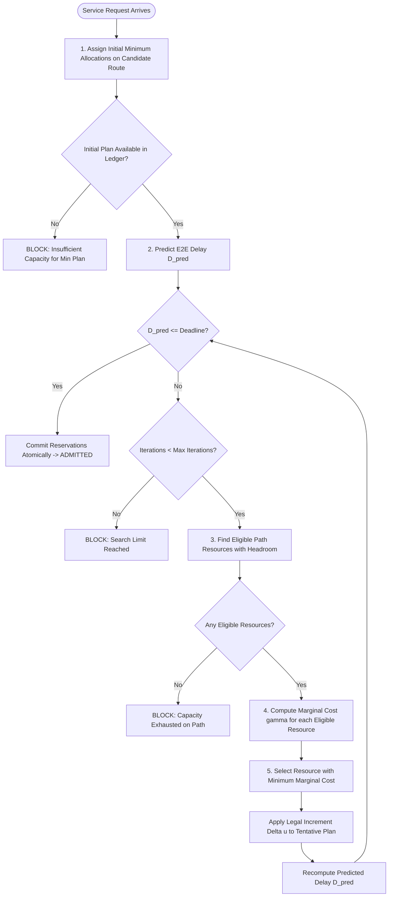

# MCRA Model Specification & Research Mapping

> **Primary Academic Reference:**  
> Jia-You Lin, Ping-Hung Chou, and Ren-Hung Hwang,  
> *"Dynamic Resource Allocation for Network Slicing with Multi-Tenants in 5G Two-Tier Networks,"*  
> **Sensors**, 23(10), 4698 (2023). DOI: [10.3390/s23104698](https://doi.org/10.3390/s23104698).

---

## 1. Academic Context & Core Innovation

In 5G networks, network slicing partitions physical network infrastructure into logical, isolated sub-networks tailored to distinct Service Level Agreements (SLAs). In two-tier architectures combining **Mobile Edge Computing (MEC)** and **Centralized Cloud Computing**, tenant requests require joint allocation of:
1. **Communication Resources (Bandwidth):** Transport across radio access, edge links, and core/backhaul links.
2. **Computation Resources (CPU / Processing Units):** Compute power at edge servers or centralized cloud data centers.

Rather than relying on static shares or blind fair-sharing (which ignores application delay budgets and capacity bottlenecks), the **Minimum Cost Resource Allocation (MCRA)** framework dynamically refines allocations in incremental units, selecting at each iteration the resource node that offers the **lowest marginal cost**.

---

## 2. Research Paper Notation to Codebase Mapping

| Paper Symbol | Concept in Paper | Implementation in Code | Location |
|---|---|---|---|
| $X$ | Resource node (link or compute) | `res_id` (`link_id` or `node_id`) | `mcra/models.py`, `resources.py` |
| $M$ / $MR^X$ | Maximum resource capacity | `capacity_mbps` / `capacity_units` | `mcra/models.py`, `resources.py` |
| $u$ / $F^X + R^X$ | Current resource occupancy/reservation | `ledger.get_used(res_id) + tentative_plan` | `mcra/allocator.py` |
| $\Delta u$ / $\alpha \mu^X$ | Discrete allocation increment | `comm_increment_mbps` / `compute_increment_units` | `mcra/allocator.py` |
| $\delta$ / $\partial$ | Convex cost-base parameter | `cost_base` (default: `2.0`) | `allocators/mcra_allocator.py` |
| $C(u)$ | Exponential resource cost | `node_exponential_cost(u, M, delta)` | `allocators/mcra_allocator.py` |
| $\gamma^X$ | Marginal allocation cost | `marginal_cost(u, inc, M, delta)` | `allocators/mcra_allocator.py` |
| $D_{max}$ | E2E latency deadline | `request.deadline_ms` | `mcra/models.py` |
| $D_{E2E}$ | End-to-end delay | `predict_route_e2e_delay_ms(...)` | `mcra/latency.py` |
| EO / CO / PH | Topology execution models | `TopologyMode.EDGE_ONLY` / `CLOUD_ONLY` / `PARALLEL_HYBRID` | `mcra/topology.py` |

---

## 3. Mathematical Formulations

### 3.1. Exponential Resource Cost Function
The cost of occupying $u$ units of a resource node $X$ with capacity $M$ is defined as:
$$C(u) = \delta^{\left(\frac{u}{M} - 1\right)}$$
*Where $\delta > 1.0$ is the cost base parameter.*

**Properties:**
* At zero occupancy ($u = 0$): $C(0) = \delta^{-1} = \frac{1}{\delta}$.
* At full saturation ($u = M$): $C(M) = \delta^{0} = 1.0$.
* The function is strictly convex: as occupancy approaches maximum capacity $M$, the derivative increases exponentially.

### 3.2. Marginal Cost of Resource Increment
The marginal cost $\gamma(u, \Delta u, M)$ of expanding allocation by a legal unit $\Delta u$ is:
$$\gamma(u, \Delta u, M) = C(u + \Delta u) - C(u) = \delta^{\left(\frac{u + \Delta u}{M} - 1\right)} - \delta^{\left(\frac{u}{M} - 1\right)}$$

### 3.3. End-to-End Latency Model
Total end-to-end delay along a candidate route consists of:
$$D_{E2E} = D_{queue} + \sum_{l \in \text{Links}} (D_{serialization}(l) + D_{propagation}(l)) + D_{compute}$$
Where:
* **Serialization Delay:** $D_{serialization}(l) = \frac{\text{payload bits}}{\text{rate}(l) \times 1,000} \text{ (ms)}$
* **Propagation Delay:** Configured physical transit delay in ms.
* **Computation Delay:** $D_{compute} = \frac{\text{compute demand}}{\text{compute rate}} + \text{base delay} \text{ (ms)}$

---

## 4. MCRA Iterative Allocation Algorithm Workflow

---

## 5. Scope, Educational Adaptations, and Caveats

1. **Discrete-Event Packet/Flow Abstraction:** This simulator models packet-flow queues and scheduling at the millisecond scale. It does not model physical radio modulation (OFDM symbols, QAM, beamforming, or channel fading).
2. **Deterministic Reproducibility:** Fixed random seeds guarantee identical arrival times and payload sizes across comparative runs.
3. **Atomic Multi-Resource Isolation:** Allocations across multiple links and compute nodes commit atomically (all-or-nothing), completely eliminating resource reservation leaks upon rejection.

---

## 6. Trace Playback & Empirical Benchmarking

To support research validation against real-world network traffic, the simulator includes a `TraceReplayer` module supporting two empirical trace formats:

1. **Commercial 5G NR CSV Traces (`data/traces/`):**
   - `5g_nr_embb_video.csv`: High-throughput variable-bitrate video stream.
   - `5g_nr_urllc_telemetry.csv`: Ultra-reliable industrial control telemetry bursts.
   - `5g_nr_mmtc_smartgrid.csv`: Periodic massive IoT sensor reports.
2. **Standard NS-3 ASCII Trace Format:**
   - `ns3_ascii_trace_sample.txt`: Native NS-3 ASCII packet event log (`+`, `-`, `r`, `d` tokens). Parses packet enqueue events, millisecond timestamps, and payload byte lengths.

Both formats feed directly into `MCRATrafficGenerator` via `--scenario trace_playback` or `--scenario ns3_trace`, enabling direct evaluation of the MCRA scheduler against empirical commercial and NS-3 traces.
