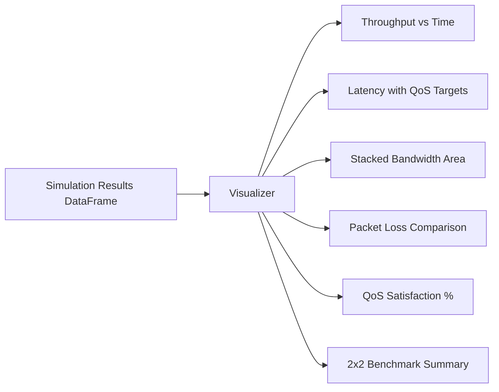

# Module Documentation: `visualization/`

## 1. Overview
The `visualization/` module transforms raw simulation telemetry into clear graphical plots using `matplotlib`. It uses a non-interactive headless backend (`Agg`) to support fast file exports in automated scripts and CLI runs.

---

## 2. File Deep-Dive: `visualization/plots.py` — `Visualizer` Class

### 2.1. Initialization & Styling
```python
import matplotlib
matplotlib.use('Agg')
import matplotlib.pyplot as plt

class Visualizer:
    def __init__(self, output_dir='results/graphs'):
        self.output_dir = output_dir
        self.colors = {'eMBB': '#2196F3', 'URLLC': '#F44336', 'mMTC': '#4CAF50'}
        self.qos_latency = {'URLLC': 5, 'eMBB': 100, 'mMTC': 200}
```
*   **Palette Standardization:** eMBB is always **Blue** (`#2196F3`), URLLC is always **Red** (`#F44336`), and mMTC is always **Green** (`#4CAF50`).
*   **SLA References:** Dashed threshold lines visualize strict SLA bounds.

---

## 3. Plot Methods Breakdown

### 1. `plot_throughput_over_time(self, df, scenario, algorithm=None, save=True)`
*   **Type:** 2D Multi-line chart.
*   **X-Axis:** Simulation Time (seconds, $0 - 59$).
*   **Y-Axis:** Throughput in Mbps.
*   **Purpose:** Shows real-time delivered bandwidth across all three slices.
*   **Output File:** `throughput_<scenario>_<algorithm>.png`

### 2. `plot_latency_over_time(self, df, scenario, algorithm=None, save=True)`
*   **Type:** 2D Multi-line chart with horizontal dashed threshold lines.
*   **X-Axis:** Simulation Time (seconds).
*   **Y-Axis:** Latency in milliseconds (ms).
*   **Key Feature:** Overlays dashed target lines (`5 ms` for URLLC, `100 ms` for eMBB) to visually highlight SLA violations.
*   **Output File:** `latency_<scenario>_<algorithm>.png`

### 3. `plot_allocation_over_time(self, df, scenario, algorithm=None, save=True)`
*   **Type:** Stacked Area Chart (`plt.stackplot`).
*   **X-Axis:** Simulation Time (seconds).
*   **Y-Axis:** Total Bandwidth Allocated (Mbps, capped at 100 Mbps).
*   **Purpose:** Shows dynamic resource reallocation. For example, during the URLLC emergency at $t=40\text{s}$, the red area expands, squeezing the blue eMBB area.
*   **Output File:** `allocation_<scenario>_<algorithm>.png`

### 4. `plot_packet_loss(self, df, scenario, save=True)`
*   **Type:** Grouped Bar Chart.
*   **X-Axis:** Allocation Algorithm (`Static`, `Round Robin`, `QoS Adaptive`).
*   **Y-Axis:** Average Packet Loss (%).
*   **Purpose:** Highlights how QoS Adaptive reduces packet loss for critical slices compared to static slicing.
*   **Output File:** `packet_loss_<scenario>.png`

### 5. `plot_qos_satisfaction(self, df, save=True)`
*   **Type:** Grouped Bar Chart across all scenarios.
*   **X-Axis:** Allocation Algorithm.
*   **Y-Axis:** QoS Satisfaction Percentage ($0 - 100\%$).
*   **Output File:** `qos_satisfaction_summary.png`

### 6. `plot_resource_utilization(self, df, scenario, save=True)`
*   **Type:** Multi-line chart.
*   **X-Axis:** Simulation Time (seconds).
*   **Y-Axis:** Total Network Utilization Percentage (%).
*   **Output File:** `utilization_<scenario>.png`

### 7. `plot_algorithm_comparison(self, df, save=True)`
*   **Type:** $2 \times 2$ Multi-Panel Summary Figure:
    *   *Top-Left:* Average Throughput (Mbps)
    *   *Top-Right:* Average Latency (ms)
    *   *Bottom-Left:* Average Packet Loss (%)
    *   *Bottom-Right:* Overall QoS Satisfaction (%)
*   **Output File:** `algorithm_comparison_summary.png`

### 8. `generate_all_plots(self, df)`
Orchestrator function that batch-generates all 13+ plot permutations for all scenarios and algorithms present in the provided DataFrame.

---

## 4. Visual Evidence Flow in Presentation



---

## 5. Viva / Defense Preparation Questions
1. **Q:** *Why is a Stacked Area Chart preferred for bandwidth allocation?*
   * **A:** It immediately reveals how the total 100 Mbps pool is partitioned among slices at every second and visually proves that the sum of slice allocations never exceeds total physical capacity ($100\text{ Mbps}$).
2. **Q:** *Why was `matplotlib.use('Agg')` configured?*
   * **A:** `Agg` is a non-interactive raster backend that directly writes image buffers to disk without requiring a graphical display server (GUI window). This avoids GUI thread locks on servers or Windows background tasks.
